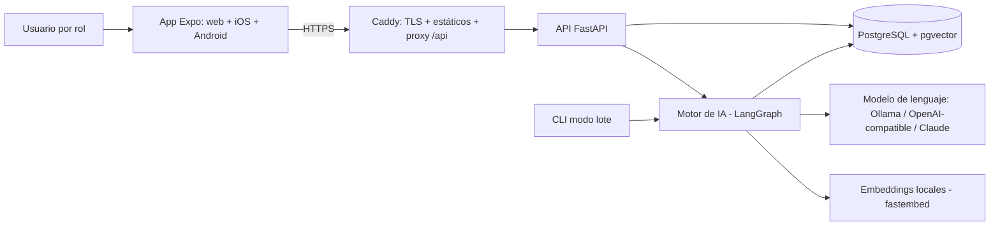
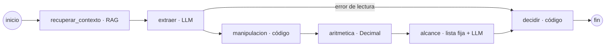

# System Design — Agente Evaluador de Propuestas

> Hackatón Venezuela INNOVA 2026 · Reto C. Documento vivo: si el código y este documento difieren, se corrige uno de los dos en el mismo PR.
> Complementa `arquitectura.pdf` (plan de trabajo). Estándares de código: [`ESTANDARES.md`](ESTANDARES.md).

## 1. Objetivo y principios

Evaluar de 3 a 20 propuestas para dotar un laboratorio de 11 computadoras, explicar cada decisión y gestionar la revisión del comité.

1. **La IA lee y propone; el código calcula y decide.** El veredicto sale de hallazgos con evidencia, nunca de un número del modelo.
2. **Las propuestas son datos no confiables.** El modelo no tiene herramientas, y las instrucciones dentro de un documento se detectan, se citan y descartan la propuesta.
3. **Un error de lectura no es un error del proveedor.** Se relee una vez; si persiste → `pendiente_de_revision`, nunca `descartada`.
4. **La persona decide la adjudicación.** El resultado de la IA no se sobrescribe; las correcciones se guardan aparte.
5. **Aislamiento multi-tenant por construcción**, no por convención.
6. **Monolito modular** hexagonal. Sin microservicios, Kubernetes ni Redis en el MVP.

### Convención de idioma (obligatoria)

El **backend y la API se escriben en inglés**; el producto que ve la persona usuaria sigue en español.

| Va en **inglés** | Va en **español** |
|---|---|
| Identificadores, módulos y archivos (`rules/scope.py`, `calculate_real_cost`), nombres de tests | Textos de la interfaz y mensajes de error que se muestran a la persona usuaria |
| Rutas y recursos de la API en plural (`/projects`, `/sessions`, `/projects/{id}/transitions`) | Documentación (`docs/`, README) y comentarios explicativos del *porqué* |
| Campos JSON, DTOs, códigos de error y valores de enums (`valid`, `discarded`, `pending_review`) | |
| Commits (Conventional Commits), ramas y nombres de variables de entorno nuevas | |

**Excepciones** (el nombre lo fija un tercero y no se traduce): las claves de `salida.json` y los nombres de las causas de descarte del enunciado (`ALCANCE`, `COMPAT`, `CAPACIDAD`, `CALIDAD`, `ABUSIVO`, `ARITMETICA`, `MANIPULACION`), que se exponen tal cual en informes y salida.

**Regla para código nuevo:** todo lo que se escriba desde ahora cumple esta tabla. **Migración del código existente:** realizada en una sola pasada coordinada (backend, API, frontend y fixtures a la vez). El glosario Español → Inglés está en [`glossary-es-en.md`](glossary-es-en.md). Se conservan en español, por ser contratos externos o de operación: el paquete `evaluador` (`python -m evaluador.lote`), los flags `--lote`/`--salida`, las variables `EVALUADOR_*`, los nombres de tablas/columnas SQL, y el vocabulario de categorías de equipos de las propuestas (`gabinete`, `monitor`, `teclado`, `raton`, `protector`).

## 2. Vista de contexto



## 3. Arquitectura hexagonal (backend)

```
backend/src/evaluador/
  domain/            Reglas puras. Sin frameworks (salvo pydantic para el contrato de extracción).
    identity.py      Tenant, User, Session, Role, Permission, política de bloqueo
    project.py       Project + máquina de estados
    extraction.py    Contrato central de extracción (montos como literal + valor)
    evaluation.py    Finding, Verdict, EvaluationResult
    rules/           arithmetic (Decimal) · scope (lista fija) · manipulation (patrones) · compatibility · capacity · quality · abusive
    rag.py           Chunk + fragmentación pura
  application/
    ports/           Contratos (typing.Protocol): output.py (repos, hasher, reloj…) y agent.py (LLM, embeddings, índice, motor)
    use_cases/       Orquestación: authentication, projects, rag, batch, exchange_rates. Aplican permisos y tenant.
  adapters/
    inbound/http/    FastAPI: dtos, guards, interceptors, routers, http_errors
    inbound/cli/     Modo lote: `python -m evaluador.lote --lote ./lote --salida ./salida.json` (paralelo y reintentos configurables)
    outbound/extraction/  Lectores: XLSX (fórmulas, valores, comentarios, ocultos), PDF (texto oculto/diminuto), imagen (visión)
    outbound/        security (Argon2id, tokens) · memory · persistence (pgvector) · ai (modelos, embeddings) · agent (LangGraph)
  composition/       Única raíz de composición + configuración por entorno
  observability/     context (trackId…), redaction, logs JSON
```

**Regla de dependencias:** `adapters → application → domain`. El dominio no importa nada de afuera. Los casos de uso dependen de **puertos**, no de implementaciones. Solo `composition/` conoce clases concretas.

### Patrones aplicados (y por qué)

| Patrón | Dónde | Motivo |
|---|---|---|
| Ports & Adapters | `application/ports` + `adapters/outbound` | Cambiar modelo, base o proveedor sin tocar reglas |
| Strategy + Factory/Registry | `ia/fabrica.py` | Proveedor de IA elegido por configuración; añadir uno = registrar, no modificar (OCP) |
| State (tabla de transiciones) | `domain/proyecto.py` | Flujo de estados explícito y verificable |
| Pipeline / Chain | grafo LangGraph | Etapas del núcleo de evaluación, cada una con una sola responsabilidad |
| Repository | `*Repositorio` | Persistencia detrás de un contrato; en memoria hoy, SQL después |
| Value Object inmutable | `Usuario`, `Sesion`, `Proyecto` (`frozen`) | Sin mutación compartida; cada cambio devuelve una instancia nueva |
| Guard / Interceptor | `guards.py`, `interceptores.py` | Autenticación, autorización y trazabilidad fuera de la lógica de negocio |
| DTO | `dtos.py` | Validación estricta en el borde; el dominio nunca ve JSON crudo |

SOLID: **S** un nodo/caso de uso = una responsabilidad · **O** proveedores y reglas por registro/lista · **L** cualquier adaptador cumple su `Protocol` (contrato probado con fakes) · **I** puertos pequeños y específicos · **D** casos de uso reciben puertos por constructor.

## 4. Seguridad e identidad (multi-tenant)

**Login:** `POST /api/v1/sessions {email, password}`. Solo correo y contraseña: el usuario no elige ni escribe organización.

- El **tenant** se **deduce del usuario** a partir de su correo, que es **único en todo el sistema**. Desde ahí **el tenant sale de la sesión en el servidor**, jamás del cliente (un campo `organization` en el payload se rechaza con 422).
- Si el tenant del usuario está inactivo, el login falla con el mismo 401 genérico. Todos los puertos de lectura reciben `tenant_id` y el adaptador **debe** filtrar por él (también el índice vectorial).
- Un recurso de otro tenant responde **404**, igual que uno inexistente.
- Contraseñas con **Argon2id** + rehash automático si cambian los parámetros.
- Token de sesión **opaco de 256 bits**; en el almacén solo se guarda su **SHA-256**. Expira por inactividad (30 min) y por vida máxima (8 h); logout lo revoca.
- **Sin enumeración:** usuario inexistente, tenant inactivo, clave errónea, cuenta inactiva o bloqueada → mismo 401, mismo mensaje y mismo coste de tiempo (verificación ficticia).
- **Bloqueo** tras 5 fallos (15 min) + límite de 10 intentos/min por IP.
- **Autorización por permisos** (matriz por rol, mínimo privilegio) en dos capas: guard HTTP y caso de uso.
- Cabeceras de seguridad en toda respuesta; CORS con lista explícita; docs OpenAPI desactivadas en producción; tope de 1 MiB por payload.
- Errores de validación **no devuelven el valor recibido** (evita eco de contraseñas).

| Rol | Crear/cargar | Iniciar eval. | Estado | Resultados | Notas | Adjudicar/cerrar | Auditoría |
|---|---|---|---|---|---|---|---|
| loader | ✔ | ✔ | ✔ | – | – | – | – |
| evaluator | – | ✔ | ✔ | ✔ | ✔ | – | – |
| approver | – | – | ✔ | ✔ | ✔ | ✔ | – |
| auditor | – | – | ✔ | ✔ | – | – | ✔ |

## 5. Observabilidad y trazabilidad

Un **interceptor ASGI** asigna a cada petición un `trackId` (respeta uno válido del cliente, si no genera UUID) y fija un contexto (`contextvars`): `trackId`, `ip`, `sessionId`, `tenantId`, `userId`. El guard de autenticación enriquece sesión/tenant/usuario. **Todo log** (HTTP, auditoría, motor de IA) sale en JSON con ese contexto; el `trackId` vuelve en la cabecera `X-Track-Id` y en los errores.

**Datos sensibles:** el cuerpo de la petición se parsea y se **censura antes de loguear** (`password`/`contrasena`, `token`, `authorization`, `cookie`, `secret`, `rif`, `hash`… → `***`; correos → `a***@dominio`; `Bearer xxx` en texto → `Bearer ***`). Los `extra` de cualquier log pasan por la misma censura (defensa en profundidad). Las excepciones se registran por **tipo**, sin mensaje ni traza que pueda arrastrar datos.

La IP solo se toma de `X-Forwarded-For` si `EVALUADOR_CONFIAR_EN_PROXY=true` (Caddy como único ingreso).

## 6. API (prefijo `/api/v1`, recursos en plural e inglés)

| Método y ruta | Función | Permiso |
|---|---|---|
| `POST /sessions` | Iniciar sesión | público (con límite) |
| `DELETE /sessions/current` | Cerrar sesión | autenticado |
| `GET /users/current` | Usuario de la sesión | autenticado |
| `GET, POST /projects` | Listar / crear | view_state / create_project |
| `GET /projects/{id}` | Detalle | view_state |
| `POST /projects/{id}/transitions` | Cambiar de estado | según destino |
| `GET /health` | Liveness | público |

Convenciones: verbos HTTP semánticos, sin verbos en la ruta, ids UUID validados por patrón, errores `{code, message, track_id}` (el texto de `message` sigue en español), 401 sin sesión, 403 sin permiso, 404 también para otro tenant, 409 transición inválida, 422 payload inválido. Previstas: `/projects/{id}/proposals`, `/evaluations`, `/evaluations/{id}/events`, `/evaluations/{id}/export`, `/evaluations/{id}/chat`, `/audit`, `/exchange-rates`.

## 7. Motor de IA (LangGraph) y RAG



- **Estado:** `EstadoEvaluacion` (TypedDict); `hallazgos` se acumula, el resto lo reemplaza cada nodo.
- **Quién hace qué:** el LLM solo *extrae* y *juzga lo cualitativo*. Aritmética (`Decimal`, coincidencia exacta), manipulación, alcance fijo y **decisión** son código.
- **Defensa contra inyección:** el documento viaja en un bloque `<documento>` etiquetado como dato; el modelo no tiene herramientas; salida validada con Pydantic; las instrucciones ocultas se detectan por **patrones en código** (no se confía en que el modelo las reporte).
- **Modelos automatizables:** `EVALUADOR_IA_PROVEEDOR` + `EVALUADOR_IA_MODELO` + `EVALUADOR_IA_BASE_URL`. Por defecto `openai_compatible` apuntando a **Ollama** (gratis y local); `anthropic` disponible; `registrar_proveedor()` añade otros. Cambiar de modelo = cambiar variables de entorno.
- **RAG:** fragmentación con solape (900/120) → embeddings **gratuitos y locales** (`fastembed`, `paraphrase-multilingual-MiniLM-L12-v2`, 384 dim, multilingüe) → **PostgreSQL + pgvector** (similitud coseno, índice HNSW). Toda búsqueda filtra por `tenant_id` (y opcionalmente `propuesta_id`). Reindexar es idempotente.
- **Estado actual:** esqueleto funcional y probado con fakes; el nodo de mercado/costo real/ranking y el worker con cola `FOR UPDATE SKIP LOCKED` están pendientes.

## 8. Despliegue

| Pieza | Dónde | Notas |
|---|---|---|
| Frontend (estático) | `hackathon.exmachina.systems` y `cotiz-ai.exmachina.systems` | nginx del host sirve `/var/www/hackathon` (enlace atómico a la última versión; se conservan 3) |
| API | `api-hackathon.exmachina.systems` | nginx → `127.0.0.1:18001` (contenedor `api`); solo `/api/v1/` es público |
| Base de datos | contenedor `db` (pgvector) | Sin puertos publicados; red interna de Docker. No se usa el PostgreSQL del host |

- **Ingreso:** nginx del host. Sobrescribe `X-Forwarded-For` con `$remote_addr` (la API toma la IP del primer valor; así un cliente no puede falsificarla), limita `POST /sesiones` a 10/min por IP (además del bloqueo de la app) y la API a 20 req/s.
- **Contenedores:** `no-new-privileges`, `cap_drop: ALL`, FS de solo lectura, usuario no root, logs rotados, healthcheck.
- **Repetible:** `infra/deploy.sh nginx|frontend|api|tls|todo`. Solo crea archivos propios (`hackathon-*`), valida con `nginx -t` antes de recargar y no toca los demás sitios del servidor.
- **TLS:** `./infra/deploy.sh tls` (certbot) cuando el DNS de los tres nombres apunte al servidor; certbot añade el 443 y la redirección, y el script no los pisa en despliegues posteriores.
- **Secretos:** `infra/.env` (permisos 600, fuera de git).
- Cada servicio mantiene además su compose para desarrollo aislado (`backend/compose.yml`, `frontend/compose.yml`).

## 9. Frontend (Expo / React Native + web)

Una sola base de código para web, iOS y Android con **Expo Router**. Capas: `app/` (rutas) → `features/` (por dominio) → `core/` (API, sesión, config) → `design/` (tokens y componentes). Sistema de diseño en `design-system/agente-evaluador/MASTER.md` (estilo *Accessible & Ethical*, Atkinson Hyperlegible, contraste ≥ 4.5:1, objetivos táctiles ≥ 44 px). Token de sesión: `expo-secure-store` en móvil y **solo en memoria** en web (nunca `localStorage`). Cada petición envía `X-Track-Id` y se muestra en errores para soporte.

## 10. Decisiones abiertas / deuda conocida

| Tema | Estado |
|---|---|
| Persistencia SQL de usuarios/proyectos/sesiones | Hoy en memoria; adaptador SQLAlchemy + Alembic pendiente (mismos puertos) |
| Auditoría con cadena de hash | Hoy a log JSON; tabla con hash encadenado pendiente |
| Rate limit distribuido | En memoria por proceso; suficiente para un solo nodo |
| Proveedor de IA definitivo | Pendiente del evento; ya intercambiable |
| Umbral de «precio abusivo» | Configurable, a calibrar con muestras |
